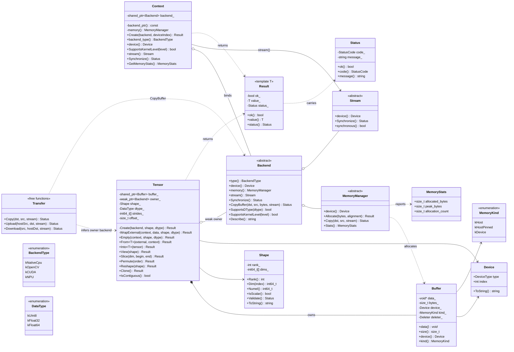
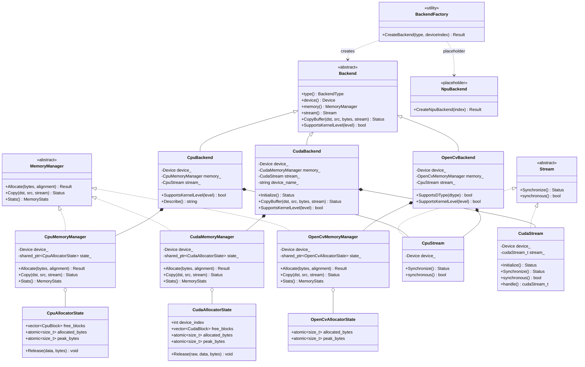
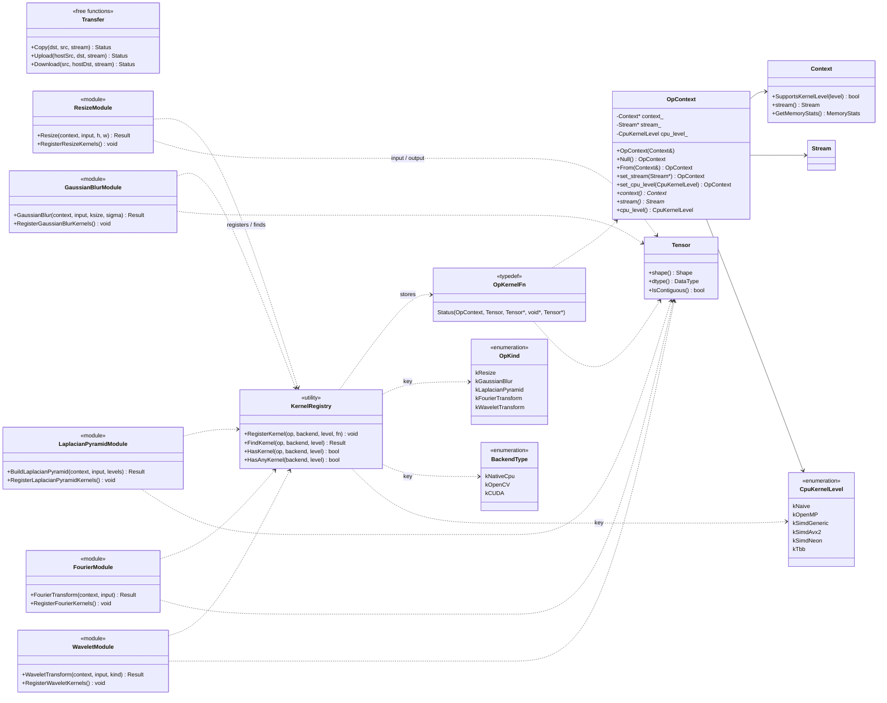

# hpcplatform 架构设计

***

## 1. 设计原则

1. **显式优先于隐式**：不做自动探测、自动回退、静默转换；后端、内核级别、布局都由调用方显式选择。
2. **可复现**：同一算子的 CPU 各版本必须位精确；只有跨后端才允许有限容差。
3. **描述与存储分离**：`Tensor` 只是元数据（shape/strides/offset），内存由 `Buffer`/`MemoryManager` 管理。
4. **后端可插拔、核心零第三方依赖**：`core` 不依赖 OpenCV/CUDA/TBB；可选能力全部由编译期开关门控。
5. **无异常**：在 `-fno-exceptions` 约束下使用 `Status`/`Result` 错误模型。
6. **错误码三分类**：参数错误 `kInvalidArgument`、编译期未启用 `kUnsupported`、注册表缺内核 `kNotImplemented`，绝不静默降级。
7. **开闭原则**：新增算子以"新增文件夹 + 一行式登记"为主，尽量不改动算子间共享的实现文件。
8. **算子自治**：每个算子文件夹是完备解决方案，包含入口、全部版本实现、构建、测试、基准与说明文档。

***

## 2. 总体架构

### 2.1 分层

```
                 include/hpcplatform/**                ← 唯一公共 API 面（调用者只见这里）
                  operator.h 等                 ← 含 Operator 基类与 LoadOperators
                        ↑
                   src/operator/                ← 配置驱动：YAML → Operator 对象（hpcplatform_WITH_YAML）
                        ↑                       ← 描述符注册表、环境解析、fail-fast 校验
                  src/framework/                ← 注册表、图像工具、dtype 分发、剖析与统计
                   ↑         ↑
        src/backends/       src/ops/
        （能力服务）          （算子自治，每算子一个文件夹）
```

`src/operator/`（`hpcplatform_WITH_YAML`）是位于 `ops`/`framework` 之上的更高一层：读取配置文件，经描述符注册表把每个条目构造为已绑定参数的 `Operator` 对象，交给业务层持有并自行编排执行。它不构建计算图，也不假设图像算法，只是把已有算子封装成可配置的对象工具。未启用 `hpcplatform_WITH_YAML` 时该层不编译，公共 `LoadOperators` 返回 `kUnsupported`。

算子自己的后端实现文件（`*_cuda.cu`、`*_opencv.cpp`）位于算子文件夹内，按需引用对应后端的服务头。

### 2.2 依赖规则

- **R1** 公共头（`include/hpcplatform/**`）不得包含任何 `src/**`。可选能力用 `#ifdef hpcplatform_WITH_*` 门控。
- **R2** `src/core/**` 不得包含 `framework`、`backends`、`ops`。`Backend` 作为 core 的内部契约定义在 `src/core/backend.h`。
- **R3** `src/framework/**` 依赖 `core` 与公共头中的稳定类型（`ops/op.h`、`ops/image.h`），不得包含 `backends` 或任何具体算子实现。
- **R4** `src/backends/**` 只依赖 `core`/`framework`，不得包含 `src/ops/**`。
- **R5** `src/ops/<op>/` 的入口与 CPU 实现只依赖公共头、`core`、`framework`、`ops/common` 与本文件夹内部头；只有 `*_cuda.cu` / `*_opencv.cpp` 等后端实现文件可以包含对应后端的服务头。
- **R6** 依赖单向无环。高层策略（算子）依赖低层能力（后端服务），后端永远不知道具体算子的存在。

***

## 3. 目录结构

```
include/hpcplatform/
  core/                  # shape / dtype / error / device / memory / stream / tensor / context / transfer
  ops/                   # image.h / op.h / resize.h / gaussian_blur.h / laplacian_pyramid.h / fourier.h / wavelet.h
  interop/opencv.h       # cv::Mat 与 Tensor 的数据适配器
  operator.h             # 配置驱动 Operator 基类与 LoadOperators（公共 API）
  hpcplatform.h                 # 伞形头

src/
  core/                  # 数据结构与内部契约
    backend.h            # Backend 接口（core 内部契约）
    copy.cpp             # Backend::CopyBuffer / CopyTensorData / Copy / Upload / Download
    copy.h               # CopyTensorData / ResolveOwningBackend 声明
    tensor_iterator.h    # 内部 stride 逐元素遍历工具（非公共 API）
  framework/             # 框架工具层
    op_registry.{h,cpp}  # 三元组内核注册表
    op_descriptor.{h,cpp}# 算子对象描述符注册表（config name → 构造器）
    image_utils.h        # 图像布局解析与索引计算
    dtype_dispatch.h     # u8/f32/f64 分发
    compiler.h           # 编译器暗示宏
    profiling.h          # 可选算子计时宏（默认零开销）
    stats.h              # 按 MemoryKind 聚合的内存快照
  backends/              # 能力服务层，不含算子实现
    backend_internal.h   # 各后端创建函数与 CUDA 拷贝辅助
    factory.cpp          # CreateBackend
    cpu/                 # CPU 内存管理器与流
    cuda/                # CUDA 内存管理器、流、设备辅助
    opencv/              # OpenCV 张量访问适配
    npu/                 # 占位后端
  ops/
    register_ops.cpp     # 唯一的算子注册清单
    CMakeLists.txt       # 每算子一行 add_subdirectory
    common/op_common.h   # ValidateInvocation / AllocateOutput
    resize/              # 自治算子文件夹
    gaussian_blur/
    laplacian_pyramid/
    fourier/
    wavelet/
  operator/              # 配置驱动算子对象层（hpcplatform_WITH_YAML）
    operator_config.h     # 内部配置结构 OperatorInstanceConfig
    yaml_parser.cpp       # YAML → OperatorsConfig
    load_operators.cpp    # 常驻 stub：未启用时返回 kUnsupported
    load_operators_real.cpp  # 真实实现（启用时编译）
    register_descriptors.cpp # 描述符登记清单

tests/
  test_utils.h           # GoogleTest 胶水层（Status 断言）；gtest_main 提供入口
  core/                  # shape / tensor / views / memory / backend / copy
  backends/              # CUDA / OpenCV 后端级测试
  perf/                  # 算子性能评估（按目标开启 profiling）
  operator/              # 配置驱动算子对象测试（hpcplatform_WITH_YAML）
                         # 每个测试文件一个 GoogleTest 可执行，由 CTest 注册
samples/                 # 公共 API 使用样例
  configs/operators.yaml # 配置驱动示例配置
```

***

## 4. 核心数据模型

### 4.1 Tensor：描述符

`Tensor` 持有 `shape`、`dtype`、`strides`、`offset`、`Buffer` 与弱引用的所属后端。创建方式：

- 用户日常入口是 `Tensor::Empty(context, shape, dtype)`：在 Context 所属后端分配新内存（深分配、拥有所有权）。分配是后端细节，公共 API 只暴露顶层工厂。
- `TensorConvert<T>` 特化实现的外部转换是透明边界：`Tensor::From<T>(external, context)` 负责把数据落到 `context` 所在域（device Context 时内部完成 H2D），`Tensor::Into<T>(tensor)` 负责从张量所在域搬回（device 张量时内部完成 D2H；非连续设备张量先 `Clone`）。用户只描述算法，不需要手动 upload/download。
- 外部数据转换统一走扩展点 `Tensor::From<T>` / `Tensor::Into<T>`，由 `TensorConvert<T>` 特化提供实现（如 OpenCV 的 `TensorConvert<cv::Mat>`）。core 不依赖任何具体第三方类型，依赖方向是"第三方类型 → TensorConvert 特化 → Tensor"，未注册类型运行时返回 `kUnsupported`。
- `Tensor::Create(backend, ...)` 与 `internal::TensorFactory::WrapExternal(context, ...)` 是库内底层工厂（不进入公共 API）：前者接受内部 `Backend`，后者绑定外部内存（`deleter` 为空表示借用，非空表示接管）。

`Slice` / `Reshape` / `Transpose` 等视图只改元数据，共享同一个 `Buffer`。

### 4.2 Buffer 与 MemoryManager

`Buffer` 是引用计数的内存块，记录字节数、设备、`MemoryKind` 与可选 `deleter`。`MemoryManager` 负责按后端分配/释放，并暴露 `Stats()`（活动字节、峰值、分配次数）。CPU 使用缓存分配器；设备内存由对应后端管理。

### 4.3 Context 与 Backend

`Context` 是用户可见的门面：创建设备上下文、访问内存管理器/流、同步，并回答后端能力查询（`SupportsKernelLevel`）。分配已上移到 `Tensor::Empty`，跨边界传输已移到 `transfer.h` 的自由函数；Context 不再承担"在哪个 Context 上调用 copy"的心智负担。

`Upload(host_src, &device_dst)` 只接受 host 源 + device 目标，`Download(device_src, &host_dst)` 只接受 device 源 + host 目标；执行者由目标/源张量的所属后端推断（`Copy` 用目标张量的 owner），所以调用方无需传入 Context，也不会"在错误的 Context 上调用"。方向与内存种类在入口处校验。`TensorConvert` 特化内部复用同一套传输原语，因此显式 API 与透明转换共享同一份拷贝语义。

`Backend` 是 core 的内部契约，职责限定为：内存管理、流、`CopyBuffer`、后端 API 封装与数据转换。后端不实现具体算子。

***

## 5. 后端服务层

`src/backends/` 是能力提供者，不是算子容器：

| 服务           | 位置                                                 | 使用者                |
| ------------ | -------------------------------------------------- | ------------------ |
| 后端接口与拷贝默认实现  | `src/core/backend.h`、`src/core/copy.cpp`           | `Context`、`Tensor` |
| 后端创建         | `src/backends/factory.cpp`                         | `Context::Create`  |
| CUDA 设备/启动辅助 | `src/backends/cuda/cuda_device_utils.h`            | 各算子 `*_cuda.cu`    |
| OpenCV 张量访问  | `src/backends/opencv/opencv_tensor_access.{h,cpp}` | 各算子 `*_opencv.cpp` |
| 图像布局与索引      | `src/framework/image_utils.h`                      | 图像算子所有版本           |

设计要点：

- 后端只暴露窄接口与稳定的服务头，算子依赖服务而非实现细节（依赖倒置）。
- 非 CPU 后端只接受 `kNaive` 级别的内核；`CopyBuffer` 不做主机中转。
- `BackendType`/`Device` 保持公共，因为 `Context::Create` 需要；但它们只是枚举/值类型，不暴露能力。
- `interop/opencv.h` 的 `TensorConvert<cv::Mat>` 特化属于对外数据适配器，不是后端能力，因此保留在公共 API；两个方向都在特化内部完成 H2D/D2H（device Context 时分配设备张量并搬运、device Into 时自动 D2H 并克隆非连续），调用方透明。新增第三方类型时只需在该类型所在的头文件里提供自己的 `TensorConvert<T>` 特化，不改 core。

***

## 6. 算子自治结构

### 6.1 文件夹契约

每个算子文件夹是一个完备解决方案：

```
src/ops/<op>/
  <op>.cpp                 # 入口：校验 → 查注册表 → 分配输出 → 调内核
  <op>_internal.h          # 参数结构体、内核原型、注册声明
  <op>_cpu.h               # CPU 共享骨架（可选）
  <op>_cpu_naive.cpp       # 参考实现
  <op>_cpu_omp.cpp         # hpcplatform_WITH_OPENMP
  <op>_cpu_tbb.cpp         # hpcplatform_WITH_TBB
  <op>_cpu_simd.cpp        # hpcplatform_ENABLE_SIMD
  <op>_cpu_avx2.cpp        # hpcplatform_COMPILER_HAS_AVX2（独立 OBJECT 库）
  <op>_cuda.cu             # hpcplatform_WITH_CUDA
  <op>_opencv.cpp          # hpcplatform_WITH_OPENCV
  CMakeLists.txt           # 逐文件宏门控 + 挂测试与基准
  tests/                   # 正确性与位精确对拍
  benchmark/               # 各版本耗时
  README.md                # 版本矩阵、容差约定、基准数据
```

契约要点：

- **文件唯一归属**：算子文件夹内的文件不被其他算子触碰。
- **版本矩阵**：README 维护 `(后端, CpuKernelLevel)` 与实现文件、对拍方式的对应表。
- **参数结构体归位**：`ResizeParams`、`GaussianBlurParams` 等定义在各自 `*_internal.h`。
- **入口骨架固定**：校验 → 查注册表 → 分配输出 → 调内核；公共头只声明 API。
- **版本不齐不是错误**：某组合没有实现时，注册表返回 `kNotImplemented`，`SupportsKernelLevel` 返回 false。
- **AVX2 构建**：AVX2 翻译单元编成独立 OBJECT 库（`-mavx2` + `hpcplatform_ARCH_AVX2`），再嵌入 `hpcplatform`，避免污染整个静态库的可移植性。

### 6.2 内核纪律

- CPU 各版本之间位精确（`memcmp` 对拍 naive 基准）。
- 跨后端使用 `1e-4` 相对容差；u8 规则见 [`qa/testing.md`](./qa/testing.md)。
- 归约型算子（如高斯）必须保持与 naive 一致的累加顺序，SIMD/并行只能改变任务划分，不能改变单像素求和顺序。
- `CopyBuffer` 的同步语义、非 CPU 后端级别限制、Context 生命周期规则见 [`qa/context_copy.md`](./qa/context_copy.md)。

***

## 7. 注册与分发

### 7.1 三元组键

内核注册键为：

```
(OpKind, BackendType, CpuKernelLevel) → OpKernelFn
```

`FindKernel` 对未命中严格区分三种情况：参数不合法、后端未编译、内核未实现，分别映射到三个错误码。

### 7.2 显式注册清单

`src/ops/register_ops.cpp` 是唯一的注册入口：

```cpp
void RegisterAllKernels() {
  RegisterResizeKernels();
  RegisterGaussianBlurKernels();
  RegisterLaplacianPyramidKernels();
  RegisterFourierKernels();
  RegisterWaveletKernels();
}
```

每个算子的 `Register<Op>Kernels()` 定义在本算子文件夹内，一次性注册它的全部版本（CPU 各级 + CUDA + OpenCV）。

**不使用静态自注册**：静态库中未被引用的翻译单元可能根本不会被链接器拉入，自注册对象的构造函数可能不执行，导致内核静默缺失；补 `--whole-archive` 等链接器魔法与"显式优先"原则冲突。显式清单多一行登记，换来行为完全可预期。

### 7.3 描述符注册表（高阶：构造算子对象）

与 7.1 的**内核注册表**（低阶：`(OpKind, BackendType, CpuKernelLevel) → OpKernelFn`）不同，`src/framework/op_descriptor.{h,cpp}` 维护一张**高阶描述符注册表**：`config op name → OpDescriptor`。描述符知道一个算子需要哪些参数、如何校验、如何构造一个已绑定参数的 `Operator` 对象，但不关心具体后端的内核函数。

```cpp
struct OpDescriptor {
  const char* Name() const;        // 配置里的 op 名字，如 "resize"
  OpKind Kind() const;             // 对应内核注册表的 OpKind
  Status ValidateParams(const ParamMap&) const;
  Result<std::unique_ptr<Operator>> Construct(name, context, cpu_level, params) const;
};
```

分层职责：

- **描述符注册表**回答"这个 `op` 名字对应哪个对象构造器"。
- **内核注册表**回答"这个 `(OpKind, backend, level)` 有没有内核函数可用"。
- `LoadOperators`（`src/operator/`）串起两者：先按名字找描述符做参数校验，再用 `FindKernel(desc->Kind(), backend, level)` 确认后端可用，全部通过后才 `Construct`。任一失败整体返回错误、不构造任何对象（fail-fast，不静默回退）。

描述符同样走**显式登记清单**（`src/operator/register_descriptors.cpp` 的 `RegisterAllOpDescriptors()`），与内核清单同因同果，不使用静态自注册。

***

## 8. 框架工具层

### 8.1 归置规则

- **逐像素热路径辅助**：`inline` 定义在 `src/framework/*.h`，随使用方内联。例如 `ImageByteOffset`。
- **一次性冷路径函数**：声明在头文件，定义落 `.cpp`，改实现只重编一个 TU。当前 `image_utils.h` 仍整体 header-only，新增冷路径函数时按此规则拆分。
- 不为了"统一"把热函数改成跨 TU 调用，除非有测量结果支撑。

### 8.2 剖析与统计

- `profiling.h`：`hpcplatform_PROFILE_SCOPE` / `hpcplatform_PROFILE_OP`，默认展开为空语句；只对需要剖析的目标定义 `hpcplatform_ENABLE_PROFILING=1`。
- `stats.h`：`SnapshotMemory(Context&)` 按 `MemoryKind` 聚合活动字节、峰值与分配次数，用于峰值和泄漏检查。
- 算子 `benchmark/` 直接使用 `std::chrono::steady_clock`，不强依赖剖析宏。
- 性能评估用例见 `tests/perf/test_operator_perf.cpp`。

### 8.3 dtype 分发

`dtype_dispatch.h` 提供 `DispatchImageDType`（u8/f32/f64）。类型分支集中在入口，内核实现保持单一类型模板，避免在每个版本里重复 switch。

***

## 9. 构建与开关

- 可选后端：`hpcplatform_WITH_CUDA`、`hpcplatform_WITH_OPENCV`、`hpcplatform_WITH_YAML`，CPU 并行与 SIMD：`hpcplatform_ENABLE_OPENMP`、`hpcplatform_ENABLE_TBB`、`hpcplatform_ENABLE_SIMD`；均为默认 ON。
- 配置驱动算子对象：`hpcplatform_WITH_YAML` 启用后引入 yaml-cpp，提供 `LoadOperators` 与 `Operator` 对象；关闭时 `LoadOperators` 返回 `kUnsupported`。
- 剖析开关：`hpcplatform_ENABLE_PROFILING` 按目标开启，库默认零开销。
- 各算子通过自己的 `CMakeLists.txt` 逐文件门控；未启用时对应翻译单元不参与编译。
- 默认只维护一条全特性构建链：`build_debug`（Debug + ASan/UBSan）或 `build_release`（Release）；测试统一使用 GoogleTest + CTest。旧的 default / full / asan 三棵树验证矩阵已废弃。
- 打包：`cpack -G TGZ` / `cpack -G DEB`，安装布局由根 [`CMakeLists.txt`](../CMakeLists.txt) 的 `install()` 规则决定。

***

## 10. 扩展指南

**新增算子 X**：

1. `include/hpcplatform/ops/x.h` —— 公共 API。
2. `include/hpcplatform/ops/op.h` —— `OpKind` 追加枚举值（append-only）。
3. `src/ops/x/` —— 自治文件夹（入口、内部头、各版本实现、CMake、tests、benchmark、README）。
4. `src/ops/register_ops.cpp` —— 加一行 `RegisterXKernels();`。
5. `src/ops/CMakeLists.txt` —— 加一行 `add_subdirectory(x)`。
6. `include/hpcplatform/hpcplatform.h` —— 加一行 include。

**给已有算子加后端实现**：算子文件夹加一个实现文件 + `Register<Op>Kernels()` 加一行宏门控注册 + 算子 CMake 加一行。core/backends/其他算子零改动。

**新增后端 B**：`src/backends/b/`（内存管理器 + 流）+ `src/backends/factory.cpp` 加一个 `case` + 构建开关。各算子自愿增量添加 `*_b.cpp`，不添加也不破坏现有构建。

**让已有算子支持配置驱动实例化**（`hpcplatform_WITH_YAML`，详见 [`operator_config.md`](./operator_config.md)）：

1. 公共头 `include/hpcplatform/ops/<op>.h` 追加 `class <Op>Operator : public Operator`（持有强类型参数，`Run(...)` 调已有公共函数）。
2. 算子文件夹新增 `<op>_operator.cpp`：实现 `<Op>Operator` + `<Op>Descriptor : public OpDescriptor`（`ValidateParams` 校验必填/类型，`Construct` 解析并构造对象）+ `Register<Op>Descriptor()`。
3. 算子 `CMakeLists.txt` 在 `if(hpcplatform_WITH_YAML)` 下追加该 `.cpp`。
4. `src/operator/register_descriptors.cpp` 的 `RegisterAllOpDescriptors()` 加一行 `Register<Op>Descriptor();`。
5. 在 `docs/operator_config.md` 登记该算子的参数表。

core / framework / 其他算子均零改动；未启用 `hpcplatform_WITH_YAML` 时新文件不参与编译，不影响默认构建。

***

## 11. 关键设计模式

| 模式              | 落点                                        | 作用                          |
| --------------- | ----------------------------------------- | --------------------------- |
| Strategy        | 每算子多版本内核 + `CpuKernelLevel`               | 同一语义的不同实现可替换                |
| Factory         | `CreateBackend`                           | 屏蔽后端构造细节                    |
| Registry        | `op_registry.{h,cpp}`                     | 三元组到内核函数的延迟绑定               |
| 描述符注册表         | `op_descriptor.{h,cpp}`、`register_descriptors.cpp` | 配置名到算子对象构造器的延迟绑定，与内核注册表分层 |
| Facade          | `Context`                                 | 对调用者隐藏后端与内存管理               |
| Adapter         | `interop/opencv.h`、`opencv_tensor_access` | 外部 `cv::Mat` 与 `Tensor` 互操作 |
| Template Method | `<op>_cpu.h` 共享骨架                         | 固定遍历/边界/累加骨架，版本只填热点         |
| RAII            | `Buffer`、`Result`、`Stream`                | 资源与错误生命周期自动收敛               |
| 编译期多态           | `hpcplatform_WITH_*` / `hpcplatform_ENABLE_*`           | 零运行时开销的可选能力                 |

***

## 12. UML 类图

类图使用 Mermaid `classDiagram`（Markdown 原生渲染，无需额外运行时）。按模块拆分为三张图，避免单图过大。

### 12.1 core 数据模型



### 12.2 后端实现



### 12.3 算子、注册表与分发



